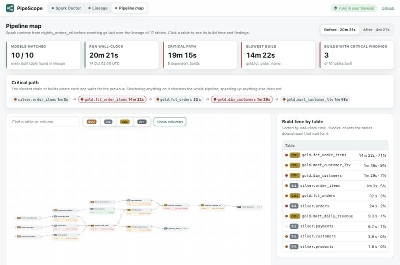
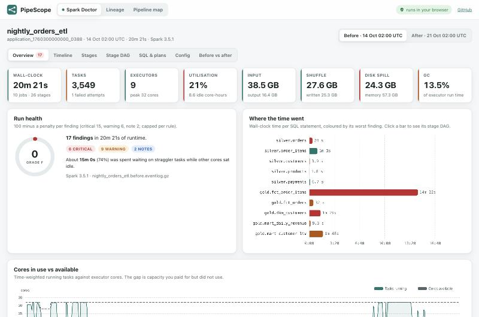
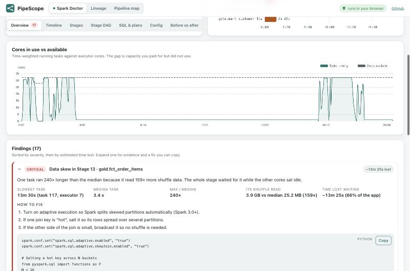
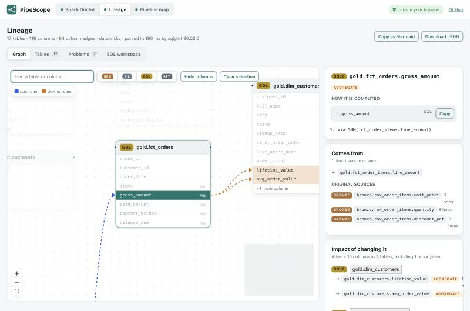
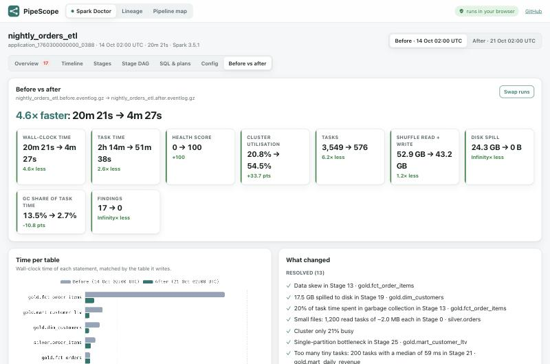
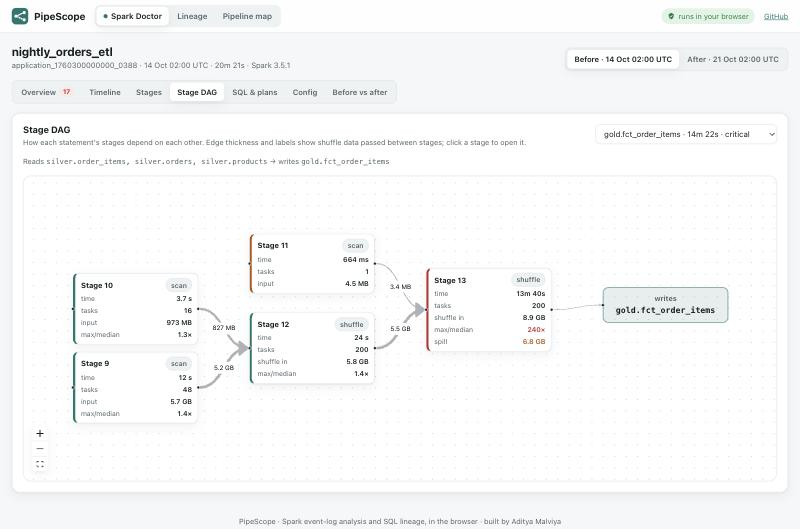
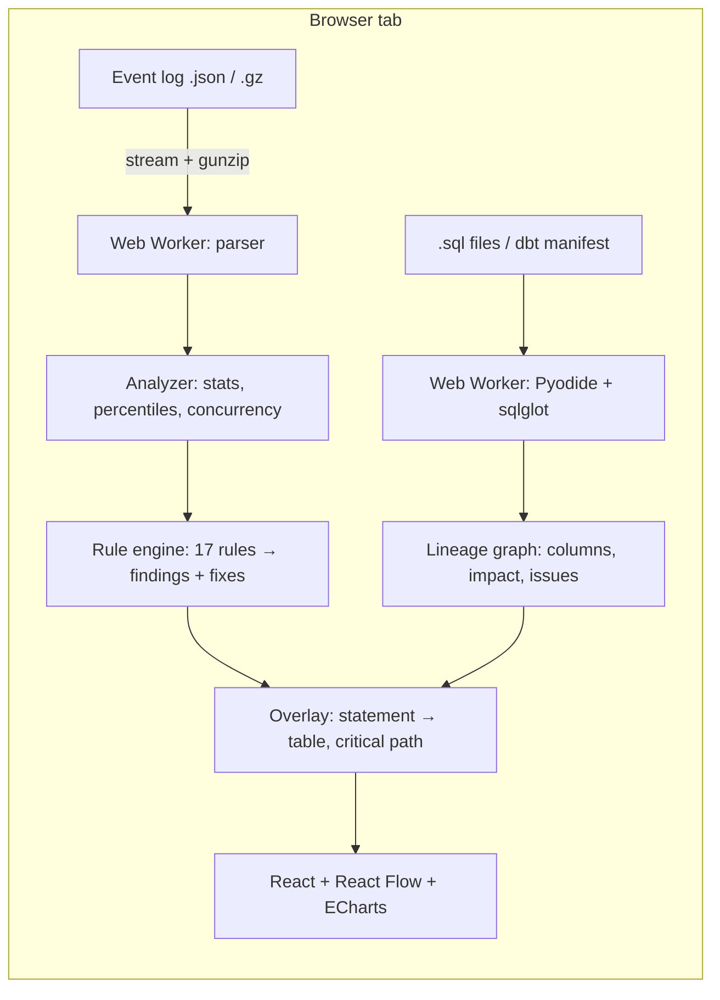

# PipeScope

**See why your data pipeline is slow, and what it feeds.** PipeScope combines a **Spark Job Doctor** (drop an event log, get findings with fixes) with a **column-level Lineage Explorer** (drop your SQL or dbt project). It then overlays one on the other: every table on the lineage graph shows how long it took to build and what went wrong.

It is a static site: logs are parsed in a Web Worker and SQL lineage runs **Python (sqlglot) inside the browser via Pyodide**. Nothing is uploaded, and it is hosted free on GitHub Pages.

**[Live demo →](https://adityamalviya04692.github.io/pipescope/)** · click **"Explore the demo pipeline"**




---

## What it does

### 1. Spark Doctor

Drop one or two Spark event logs (plain or `.gz`, from `spark.eventLog.dir`).

| | |
|---|---|
| **Run health** | 0–100 score, wall-clock, tasks, executors, cluster utilisation and idle core-hours, input, shuffle, spill, GC. |
| **Findings, each with evidence and a copyable fix** | Data skew (with time lost to stragglers), disk spill, GC pressure, small files, too many tiny tasks, single-partition bottlenecks, low parallelism, idle cluster, failed tasks and lost executors, AQE or broadcast disabled, broadcast candidates, Python UDFs, cartesian joins, shuffle-partition sizing, serializer. |
| **Timeline** | Gantt of every SQL statement and stage, plus cores-in-use vs cores-available over time. |
| **Stages** | Sortable stage table. Per stage: Spark-UI-style percentiles, a task-duration histogram, a size-vs-duration scatter (skew jumps out), a task timeline per executor, and the slowest tasks. |
| **Stage DAG** | Interactive DAG per statement, with shuffle bytes on the edges. |
| **SQL & plans** | Physical plans with bottleneck operators highlighted, and the tables each statement reads and writes. |
| **Config audit** | Key settings judged against what actually happened in the run. |
| **Before vs after** | Load a second run: speed-up, metric deltas, time per table, findings resolved and introduced. |




### 2. Lineage Explorer

Drop `.sql` files (any order) or a dbt `target/manifest.json`.

- **Column-level lineage** through CTEs, subqueries, joins, aggregates, window functions, `CASE`, `SELECT *` (expanded from known schemas), `INSERT` (by name or position) and `MERGE` (from its WHEN clauses).
- **Transform type for every column**: direct, renamed, cast, derived, aggregate, window, constant. Includes the expression and the intermediate steps.
- **Impact analysis**: click a column to see every downstream column, table and report it affects, plus where it changes *which rows* appear (filters, join keys, group-bys).
- **Problems and insights**: parse errors per statement, `SELECT *`, cycles, orphan models, unused columns, PII reaching gold or reporting layers, high-impact columns.
- **dbt aware**: uses compiled SQL, model and column descriptions, and tests (`unique`, `not_null`, …). The SQL dialect is taken from the adapter.
- **SQL workspace**: edit models in a CodeMirror editor and re-analyse instantly. Export as JSON or Mermaid.
- Ten dialects: Databricks, Spark, Snowflake, BigQuery, Postgres, Redshift, SQL Server/Fabric, DuckDB, Trino, MySQL.



### 3. Pipeline map

With both loaded, each Spark statement is matched to the lineage table it builds:

- Build time, share of the run and worst finding on every table node.
- The **critical path**: the slowest chain of dependent builds, which bounds end-to-end time.
- A ranking of builds by time, with how many downstream tables each one blocks.
- Click a table to see its findings next to its lineage.

## The demo pipeline

A nightly orders ETL on a Databricks-style lakehouse: bronze → silver → gold → reporting. It has 12 SQL files and two Spark runs of the same job, one untuned and one tuned.

| | Before tuning | After tuning |
|---|---|---|
| Wall-clock | 20m 21s | 4m 27s (**4.6× faster**) |
| Health score | 0 (F), 17 findings | 100 (A), 0 findings |
| Cluster utilisation | 21% | 54% |
| Tasks | 3,549 | 576 |

The demo data is **synthetic**. `scripts/generate-eventlogs.mjs` simulates a cluster scheduler and writes genuine Spark JSON event logs with planted problems: 1,200 small files, a hot `product_id` that turns one task into a 13-minute straggler with 6.8 GB of spill, a GC-bound window, 200 tiny shuffle tasks, a Python UDF, a single-partition `RANK()`, an OOM-killed executor, and AQE and broadcast turned off. The tuned run applies the fixes that PipeScope recommends.




## Architecture



## Engineering decisions

- **Streaming, off the main thread.** Event logs can be hundreds of MB. They are streamed through `DecompressionStream` and a line splitter inside a Web Worker, so the UI never freezes and the decompressed text is never held in memory.
- **Real Spark event-log format.** The parser reads Spark's `JsonProtocol` events directly (task metrics, stage infos, SQL executions, AQE plan updates, executor lifecycle), so it works on logs from Spark 3.x, Databricks, EMR or Synapse.
- **Rules are data, not opinions.** Every rule has an explicit threshold (`src/spark/rules.ts`, `T`), shows the evidence it used, and estimates time lost where that can be measured (straggler time = max − p90 task).
- **Utilisation is integrated, not sampled.** Running tasks and available cores are integrated over time into buckets. That gives exact core-hours offered vs used, and so the idle cost.
- **sqlglot in the browser.** Writing a column-lineage parser is a research project. sqlglot is the industry-standard SQL parser and optimizer (it powers SQLMesh), so PipeScope runs it unmodified in Pyodide. The Pyodide runtime and a **checksum-verified, version-pinned** sqlglot wheel are self-hosted, so there is no CDN and no SQL ever leaves the page.
- **Order-independent analysis.** Statements are sorted topologically and the schema is built up as each model is analysed. Files can be dropped in any order, and `SELECT *` from an upstream model still expands.
- **Fail soft.** Files are split per statement with sqlglot's own tokenizer, so one bad statement is reported with its line number and the rest still traced. Unsupported syntax that sqlglot silently falls back on is surfaced, not hidden.
- **Two test suites in CI.** 16 pytest tests for the Python engine and 36 Vitest tests for parsing, rules, graph traversal and overlay, including an integration test that runs the real demo logs and asserts every planted problem is found.

## Tech stack

TypeScript · React 19 · Vite · Web Workers · Pyodide 314 (Python 3.14) · sqlglot · React Flow + dagre · Apache ECharts · CodeMirror 6 · Vitest · pytest · GitHub Actions · GitHub Pages

## Run locally

```bash
npm install
npm run dev             # vendors Pyodide + sqlglot into public/pyodide, then starts Vite
npm test                # TypeScript tests
python3 -m venv .venv && .venv/bin/pip install -r requirements-dev.txt
.venv/bin/python -m pytest -q tests/python   # lineage engine tests
npm run build           # production build in dist/
npm run samples         # regenerate the demo event logs
```

To analyse your own Spark jobs, set `spark.eventLog.enabled=true` and drop the file from `spark.eventLog.dir`. Databricks: *Compute → cluster → Logging*. For dbt, run `dbt compile` and drop `target/manifest.json`.

## Deploy (free)

1. Push to a public GitHub repository named `pipescope`.
2. In the repository, go to **Settings → Pages → Source** and choose **GitHub Actions**.
3. Every push to `main` runs the Python tests, typecheck, TypeScript tests and build, then deploys.

## Limitations

- lz4, snappy and zstd-compressed event logs need decompressing first. Browsers only ship gzip.
- Column lineage is static analysis of SQL. DataFrame or PySpark transformations are not traced; their table-level reads and writes still come from the Spark plans.
- Rule thresholds are sensible defaults, not universal truths. Each one is a constant you can tune.

## License

MIT © Aditya Malviya
